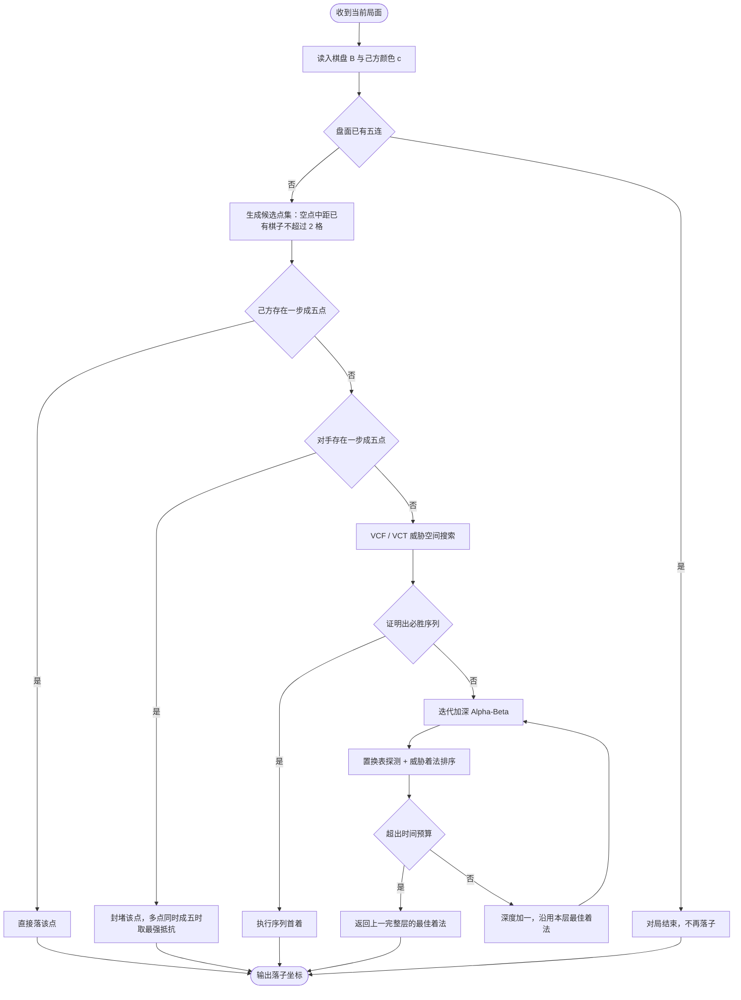
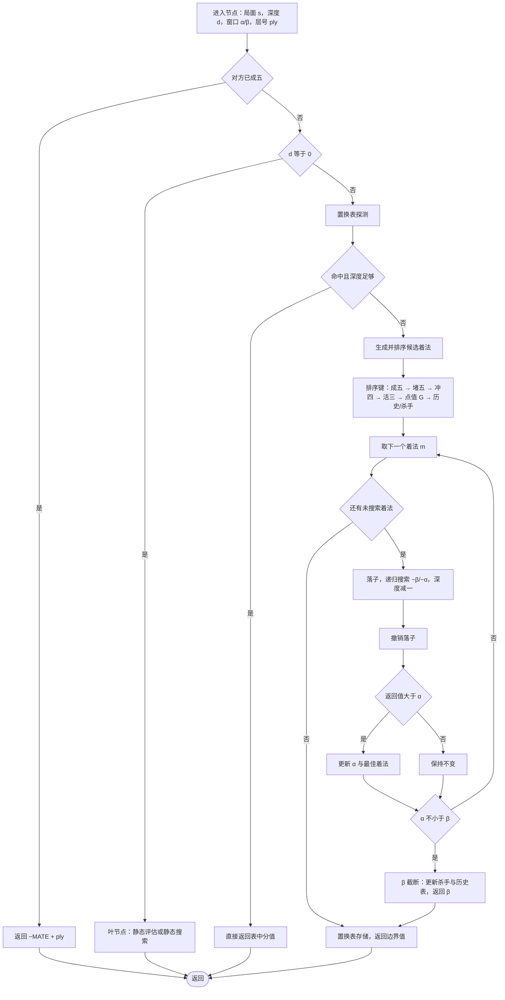
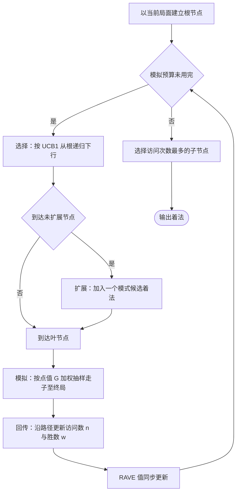
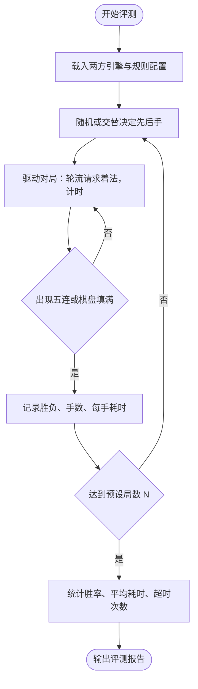

# 五子棋 AI 算法设计报告（设计稿 v0.1）

> **课程**：算法设计与分析（2026 秋 · 大数据 24-1/2 大作业）
>
> **选题**：题目 B —— 五子棋 AI（与基准 AI 对战，按胜率评分）
>
> **状态**：**设计阶段**。本文只做问题拆解、估值推导、两套候选方案与复杂度分析；**不含最终代码**，待确认算法路线后再进入实现。
>
> **来源文件**：`2026秋-大数据24-1、2-算法设计与分析-大作业题目及要求.docx`（B 节，段落 28–40）

---

## 0. 结论先行（TL;DR）

| 项目 | 结论 |
|---|---|
| 问题本质 | 有限、完美信息、零和博弈；**威胁驱动**——胜负由 3–9 步的强制着法序列决定，而不是由"当前谁的点值大"决定 |
| 题目给的 F | `F = maxG1 − maxG2` 是 **1-ply 的点值极差**，可作**着法排序键**，但**不能直接当决策函数**（见 §3.5 的六条反例） |
| 方案 A（推荐） | 迭代加深 **Alpha-Beta + PVS** + Zobrist **置换表** + **威胁着法排序** + **VCF/VCT 威胁空间搜索**；深度 8–12，节点 10⁵–10⁶，内存约 20 MB |
| 方案 B（对照） | **UCT / MCTS** + 模式引导模拟策略 + RAVE；样本 10⁴–10⁵ 次模拟，内存数 MB |
| 选型理由 | B 的收敛需 ~1/Δ² 次采样；五子棋"安静局面 Δ 极小、战术局面 Δ 极大"，纯 B 在战术上系统性失明。A 的剪枝复杂度 b^{d/2} 恰好匹配"必须算清强制序列"的需求 |
| 落地路线 | 以 A 为骨架，把 B 降级为"着法先验生成器 / 对照实验"，不作为主引擎 |
| 待确认 | ① 选 A / B / A+B ② 基准 AI 的接口协议 ③ 禁手与长连规则 |

---

## 1. 题目原文要点（B 节摘录与转写）

| # | 原文要点 | 对设计的含义 |
|---|---|---|
| B1 | 标准棋盘 15×15，共 225 个交叉点 | 状态空间上界 3²²⁵，但可达局面远小于此（见 §2.3） |
| B2 | 一方在**横向、纵向或对角线**方向落下**连续 5 枚**棋子即获胜 | 只需检查 4 个方向；判定是 O(1) 局部操作 |
| B3 | 每点三态：黑 / 白 / 空 | 用 `0/1/2` 编码，配 `int8[15][15]` 或位棋盘 |
| B4 | AI 需"计算对手和己方后续若干次落子对局势的影响" | **明确要求博弈树/前瞻**，不是纯贪心 |
| B5 | 估值：`maxG1 = max{ G1(x,y) }` 取遍空点，`maxG2 = max{ G2(x,y) }` 取遍空点，`F = maxG1 − maxG2` | 题目给出了**点估值** `G` 与**局面值** `F` 的框架，需在其上扩展 |
| B6 | `F` 越大，局面对己方越有利 | 这是**静态**判据；本文 §3.5 证明它单独使用会失效 |
| B7 | 与给定基准 AI 对战，按胜率评分 | 评测目标是**实战胜率**，不是"估值函数漂亮" |

**原文公式（OMML 转写，逐字）**

```text
maxG1 = max{ G1(x,y) | 0≤x≤15, 0≤y≤15, S_{x,y}=0 }
maxG2 = max{ G2(x,y) | 0≤x≤15, 0≤y≤15, S_{x,y}=0 }
F     = maxG1 − maxG2
其中 S_{x,y} ∈ {0,1,2}：0 无子，1 黑子，2 白子
```

> **注 1（原文笔误）**：15×15 棋盘的合法下标是 `0..14`。原文写 `0≤x≤15` 会让上界多出一行一列，实现时按 `0..14` 处理，报告中按原文引用并注明。
> **注 2（术语）**：原文的 `G1`/`G2` 是"**落子后该点的价值**"，本文沿用此约定；这与"点本身的静态价值"不同，直接影响 §3.4 的分值表构造。

---

## 2. 问题拆解

### 2.1 形式化

定义局面 `s = (B, t)`：

- `B ∈ {0,1,2}^{15×15}`：棋盘；
- `t ∈ {1,2}`：**当前该谁走**（黑 = 1，白 = 2）。

落子算子 `s' = δ(s, p)`：`B'[p] = t`，`t' = 3 − t`。

终局谓词：

```text
Win(B, c) ⇔ ∃ p, ∃ d ∈ {→, ↓, ↘, ↗} :
            ∀ k ∈ {0,1,2,3,4} : B[p + k·d] = c
```

注意 `Win` 对 5 连、6 连及以上同时成立（长连包含 5 连）。**是否允许长连取胜属禁手规则范畴，待确认（§9）。**

零和效用（统一取"**该走方**"视角，配 negamax）：

```text
u(s) = −MATE + ply   若对方（上一步落子方）已成五  —— 该走方已输
u(s) = +MATE − ply   若该走方已成五              —— 正常流程不出现，防御性判定
u(s) = 0             若棋盘填满且无五连（平局）
```

`ply` 项的作用是**偏好更快的胜利 / 更慢的失败**，避免 AI"能赢却绕路"。
由于 `u(s) = −u(s̄)`，递归式 `V(s) = max_{m} −V(δ(s,m))` 即可覆盖 `max`/`min` 两层，实现上只需一套符号翻转。

### 2.2 博弈性质

| 性质 | 取值 | 算法含义 |
|---|---|---|
| 有限 | 是（≤225 手） | 博弈树有限，minimax 有定义 |
| 完美信息 | 是 | 可用确定性搜索，无需信念状态 |
| 零和 | 是 | `u(s) = −u(s̄)`，可用 **negamax** 形式 |
| 随机性 | 无 | 除 MCTS 自身采样外不引入随机 |
| 平局 | 可能存在（225 格填满而无五连） | 效用需第三态，不能只做 ±1 |
| 理论结果 | 15×15 **无禁手**五子棋**先手（黑）必胜**（Allis, van den Herik & Huntjens，1993/1996，威胁空间搜索 + 证明数搜索） | 执黑应争取必胜；执白只能靠对手失误与战术陷阱，故**执白的防守质量决定胜率** |

### 2.3 状态空间规模

- 落子序列上界：`225!/(113!·112!) = C(225,112) ≈ 2.9×10^66`（黑 113 手、白 112 手的排列数）。
- 但合法对局远小于此：五连即终止，且实际对局长度集中在 20–60 手。
- **结论**：精确求解不可行（无禁手五子棋的完整解需要 Allis 级别的威胁空间搜索 + 数月算力）。工程上必须做**深度受限搜索 + 局面评估**，这正是题目给出 `F` 的原因。

### 2.4 分支因子与候选集裁剪

朴素分支因子 `b = 225`。直接搜深度 6 就是 `225⁶ ≈ 1.3×10¹⁴`，不可行。两级裁剪：

**（1）邻域裁剪：只考虑"已有棋子 Chebyshev 距离 ≤ 2"的空点。**

> **命题 1（完备性）**：设 `p` 是某方的**一步成五点**（落下即成五），则 `p` 周围必存在距离 ≤ 2 的已有棋子。
>
> **证明**：`p` 落下后成五，说明存在含 `p` 的 5 连窗口 `W`，其中另 4 格已是该方棋子。这 4 格分布在 `p` 左侧 4 格（距离 1–4）与右侧 4 格（距离 1–4）中。若某侧占了 4 格，则该侧必有距离 1 的棋子；若两侧各 2 格，则两侧各有距离 ≤2 的棋子；若 3+1 分布，占 3 格的一侧在 4 个位置里放了 3 枚，必占距离 1 或 2 的位置。三种情形均存在距离 ≤2 的棋子。∎
>
> 推论：**所有"一步成五"点与"堵点"都在候选集内**，裁剪不丢失任何强制着法。

裁剪后候选集规模：开局 1–8，中局约 60–120，收官期可超过 150。仍偏大，需第二级。

**（2）Top-k 排序裁剪**：按"威胁等级 → 点值 G → 历史启发"排序，只保留前 `k` 个（`k = 12–16`）。

> 这是**启发式**，不保证最优，但把有效分支因子压到 `b_eff ≈ 6–8`，是深度能到 8–12 的前提。

### 2.5 难点归纳

| # | 难点 | 具体表现 | 应对（本设计） |
|---|---|---|---|
| D1 | 组合爆炸 | b=225，深度 6 即 10¹⁴ | 邻域裁剪（命题 1）+ Top-k + Alpha-Beta |
| D2 | 水平线效应 | 深度截断处恰好是"对方即将成四"，评估却给出均势 | 静态搜索（quiescence）+ 冲四延伸 + VCF 兜底 |
| D3 | 威胁的组合性 | 双活三、四三、连续冲四的胜负是**非连续跃变**，线性加权表达不了 | 显式双威胁检测 + 威胁空间搜索（§3.5、§4.4） |
| D4 | 先手（tempo） | 同一盘面，轮谁走结果相反；`F` 不含回合信息 | 搜索层显式交替；评估只用于叶节点 |
| D5 | 估值标定 | 分值表差一个数量级，AI 行为就从"稳健"变"冒进" | 对数刻度 + 自对弈调参（§8.4） |

---

## 3. 估值函数：从题目的 `G` 与 `F` 推导

题目只给了 `G1/G2` 的**形式**（"点处己方/对手的估值"），没给计算方式。本节把它落实成可计算的表，并证明 `F` 的适用边界。

### 3.1 五连窗口

对候选点 `p` 与方向 `d`，任何**经过 `p` 的 5 连窗口**最多向两侧各延伸 4 格，因此只需检查窗口 `[p−4d, p+4d]`（共 9 格，越界视为墙）。每方向经过 `p` 的 5 连窗口恰有 5 个：

```text
w_j = [p + (j−4)d, p + (j−3)d, ..., p + j·d],  j = 0..4
```

### 3.2 落子后的成五点集 `W(p, c)`

设 `c` 在 `p` 落子，定义

```text
W(p, c) = { q 为空点 | 若 c 再落 q，则 c 成五 }
```

计算方式：对 5 个窗口 `w_j`，若其中恰有 4 格为 `c`、1 格为空 `q`，则 `q ∈ W(p,c)`。因为窗口长度 5 且含 `p`，`q` 必在 `p` 的 ±5 范围内。

> 这个定义是本设计的关键：**它把"模式识别"化归为"集合基数"**，无需字符串匹配，实现是常数时间（4 方向 × 5 窗口 × 5 格 = 100 次比较）。

### 3.3 威胁等级：用"下一步可达性"递推定义

五子棋的威胁本质是"我下一步能把你逼到什么程度"，因此等级可用**可达性闭包**递归定义，而不是硬编码棋型名字。

**定义（等级，对颜色 `c` 与空点 `p`）**

记 `W(q,c)` 为"在 `p` 落子**之后**的局面里、`c` 再落 `q` 时的成五点集"。

```text
L5   : 在 p 落子后 Win(B, c) 为真                        —— 成五（终局）
L4o  : |W(p,c)| ≥ 2                                       —— 活四（两端成五，不可防）
L4s  : |W(p,c)| = 1                                       —— 冲四（一端成五，强制应）
L3o  : |W(p,c)| = 0 且 ∃ 空点 q : |W(q,c)| ≥ 2            —— 活三（下一手可成活四）
L3s  : |W(p,c)| = 0 且 ∃ 空点 q : |W(q,c)| ≥ 1，且非 L3o  —— 眠三（下一手只可成冲四）
L2   : |W(p,c)| = 0 且 ∃ 空点 q : L3o(q) 或 L3s(q) 成立   —— 活二 / 眠二
```

**为什么这样定义就够用**：五子棋的所有"棋型"（活三、冲四、四三……）都可以由 `L5/L4/L3` 这三层可达性组合出来，且 `L4o` 与 `L4s` 用 `|W|` 的基数区分，恰好对应"两端成五"与"一端成五"——比记棋型名更不容易错。

> **注意这是"一步前瞻"定义**：`L3` 需要枚举 `p` 附近（±5 内）的空点 `q` 再算一次 `W(q,c)`。单点开销约 `4 方向 × 5 窗口 × 5 格 × 10 个 q ≈ 10³` 次比较，**不能每个节点对全部候选点都算**（§3.6）。

### 3.4 点值 `G` 与局面值 `F`

**分值表（对数刻度）**

| 模式 | 记法 | 分值 | 依据 |
|---|---|---|---|
| 成五 | `L5` | `10⁷` | 终局，必须压倒一切 |
| 活四 | `L4o` | `10⁶` | 单点不可防 |
| 冲四 | `L4s` | `10⁵` | 强制对手应一手 |
| 活三 | `L3o` | `10⁴` | 强制对手应一手（且可升级） |
| 眠三 | `L3s` | `10³` | 只可成冲四 |
| 活二 | `L2o` | `10²` | 可演化为活三 |
| 眠二 | `L2s` | `10¹` | 弱 |

**为什么用 10 倍刻度**：保证"一个高一级威胁 > 任意多个低一级威胁"（`m·10^k < 10^{k+1}` 对 `m < 10` 成立，4 方向最多 4 个同向模式，恒成立）。这给出**同向内的字典序**。

**但刻度必须配一个补丁**：五子棋的胜负存在**非连续跃变**——"一子双三"是必胜，而 `2×10⁴ < 10⁵`，线性加权会把它排在"一手单冲四"之后（反例 b）。因此：

> **规则 R1（双威胁优先，覆盖标定）**：若某点落子后，4 个方向中同时出现 **≥2 个 `L4`**（四四）、或 **1 个 `L4` + 1 个 `L3o`**（四三）、或 **≥2 个 `L3o`**（双三），则该点**直接判为必胜着法**，不参与数值比较。
>
> 理由：三类双威胁都是"对手只能挡一路"的必胜结构，属于**布尔性质**而不是**可加分数**，只能显式检测，不能靠加权求和。
>
> **附注（R1 的边界）**：两处**互不相交**的活三（不在同一手内形成）不属于 R1——它需要两步才能转化，对手有时间应对，因此**必须交给搜索判定**，不能直接判胜。

**点值定义**（对应题目的 `G1/G2`）

```text
G_c(x,y) = Σ_{d ∈ 4 方向} score( 在 (x,y) 落下 c 后、方向 d 上的模式 )
```

**局面值**（对应题目）

```text
maxG1 = max{ G_t(x,y) | 空点 }        // 己方（该走方）
maxG2 = max{ G_{3−t}(x,y) | 空点 }    // 对手
F     = maxG1 − maxG2
```

### 3.5 `F` 作为决策函数为何失效（五条反例）

> 题目 B6 说"F 越大越有利"。下面证明：**把 F 直接当决策函数会输棋**，它只能作搜索内的组件。

**反例 a（无回合信息，最致命）**
黑有活三（黑走则 3 步胜：活三 → 活四 → 五）；白同时有一条连续冲四（VCF，白走则 4 步胜）。
`F` 对同一盘面给出**同一个数**（`G` 只依赖盘面，不依赖 `t`），但真实结果由"轮到谁"决定，符号相反。
→ `F` 不是状态值的函数：**`V(s) ≠ f(F(s))`**。

**反例 b（线性刻度与胜负序相反）**
局面 P：黑有一手能成**单冲四**的点（`G = 10⁵`），对手单点封堵即化解。
局面 Q：黑有一手能成**双活三**的点（两个方向各 `10⁴`，合计 `2×10⁴`），对手只能挡一路，下一手成活四 → **必胜**。
数值上 `F(P) = 10⁵ > F(Q) = 2×10⁴`，胜负上 Q 必胜、P 不胜。
→ **`max` + 线性加权给出的序与真实胜负序相反**，必须由规则 R1 显式接管。

**反例 c（`max` 是选择而非聚合）**
局面 P：一个冲四点（`10⁵`）。局面 Q：两个冲四点（各 `10⁵`，但两处相距很远）。
`F(P) = F(Q) = 10⁵`，可是两者的战术含义不同：Q 具备"连续两手强制"的压迫，P 只有一手。
→ `max` 只看最好的一点，**丢失威胁的个数**；这类信息只能由搜索的深度来补。

**反例 d（对手项是"贪心对手"假设）**
`maxG2` 取的是"对手自己进攻得分最高的点"，而真实强手会走"**最破坏我计划**的点"（minimax 语义）。二者在大量局面不同：对手可能走一个自评不高、但同时封我两路的点。

**反例 e（跨方向可加性误差）**
同一枚棋子同时属于横、纵、斜四条线，`G` 把它在 4 个方向的模式分**相加**，十字交叉的双三会被重复计分（高估），而单方向长龙的远程协同被低估。误差有界但非零。

**反例 f（无深度）**
VCF/双威胁这类"3–9 步强制序列"在 1-ply 量里**完全不可见**，而五子棋的胜负恰恰由它们决定。

**结论（设计决策）**

| `F` 的用途 | 是否可行 |
|---|---|
| 着法排序键（move ordering） | ✅ 推荐——便宜、有效 |
| 叶节点静态估值 | ⚠️ 需与线模式总分、双威胁项组合，且必须显式带 `t` |
| 直接选点（贪心 AI） | ❌ 会在该防守时进攻，**必输**给会算强制序列的对手 |

> 因此**两套方案都在 `F` 之上加了前瞻**：A 用博弈树把回合显式化，B 用模拟把序列显式化。

### 3.6 点值计算的开销与增量方案

这是本设计最容易低估的一处，必须在动代码前算清。

**朴素做法（不可行）**：每个节点对全部候选点重算 `G`。中局 `|C| ≈ 100`，每点需 `4 方向 × 5 窗口 × 5 格 ≈ 100` 次比较，且 `L3` 还要再枚举 ±5 内的空点 `q`（约 10 个）→ 单点约 `10³` 次操作 → **单节点 `10⁵` 次操作**。按 §4.5.1 的 2 µs/节点预算，超标 50 倍。

**增量做法（采用）**：

| 层次 | 数据结构 | 落子后更新代价 |
|---|---|---|
| 线级 | 全盘 72 条线（横 15 + 竖 15 + 两条对角各 21），每条线维护"模式码" | 只更新经过落子点的 **4 条线** |
| 线内 | 该线的模式分（活四/冲四/活三…） | 只重扫 4 条线 × 5 窗口 = 20 个窗口 |
| 点级 | `G(x,y)` 的 4 方向分量 | 只影响落子点附近的点（±4 范围内，约 30 个） |

更新代价从 `10⁵` 降到 **约 4 × 5 × 5 = 100** 次比较，与"每步落子"同阶，可摊还到 `make/unmake` 里。

**排序与评估的两级策略**：

1. **排序阶段**：只算便宜的 `L5 / L4`（每点 `O(1)`，`4×5` 次比较），够用来决定优先级。
2. **叶节点评估**：用线级模式分总分 `Σ score(line)` 做局面值，而不是对全部空点重算 `G`。
3. **`L3` 检测只在需要时做**：仅对 Top-k 候选（`k ≤ 16`）做完整点值，用于最终选点与 `F` 计算。

> 这条"两级策略"是把 §4.5.1 表格里的 `2 µs/节点` 变成现实的前提；否则常数因子失控，深度 10 是空谈。

---

## 4. 方案 A：迭代加深 Alpha-Beta + 置换表 + 威胁空间搜索

### 4.1 框架

```text
主决策 = 立即胜 → 立即堵 → VCF/VCT 求证 → 迭代加深 Alpha-Beta
```

关键点：**先做廉价的战术判定，再做昂贵的搜索**。顺序不可颠倒——VCF 能在 10⁴ 节点内证明的必胜，Alpha-Beta 可能要 10⁶ 节点才发现。

### 4.2 组件与选型理由

| 组件 | 作用 | 复杂度收益 | 备注 |
|---|---|---|---|
| Negamax 形式 | 统一 `max`/`min` | 代码量减半 | `u(s) = −u(s̄)` |
| Alpha-Beta | 剪枝 | 最坏 `O(b^d)` → 理想 `O(b^{d/2})` | §4.5 推导 |
| **PVS（主变例搜索）** | 非 PV 着法用零窗口 | 常数因子 0.7–0.9 | 与 `d` 无关的稳定收益 |
| **迭代加深** | 逐层加深，上一层最佳着法先搜 | 任意时刻有可用解（anytime） | 天然支持时间预算 |
| **Zobrist + 置换表** | 命中已搜索局面 | 中局节点降 30–60% | §4.5.3 碰撞分析 |
| **威胁着法排序** | 成五 → 堵五 → 冲四 → 活三 → G → 历史/杀手 | 决定 A-B 是否退化 | 排序质量 = 剪枝率 |
| **VCF/VCT** | 只搜强制着法 | 用极小分支证明必胜 | §4.4，可靠但不完备 |
| **静态搜索（quiescence）** | 叶子处若存在冲四则延伸 | 消除水平线效应 | 深度扩展 ≤ 6 |

### 4.3 伪代码（设计级，非最终代码）

```text
function SEARCH(s, d, α, β, ply):
    if WIN(s, 3 − t):  return −MATE + ply        // 对方已赢
    if d ≤ 0:          return EVAL(s, t)         // 叶节点
    e ← TT_PROBE(HASH(s))
    if e.depth ≥ d and e.flag = EXACT:  return e.score
    moves ← ORDER(GEN(s), s)                     // §4.4 排序
    best ← −∞
    for m in moves:
        s' ← δ(s, m)
        v ← −SEARCH(s', d−1, −β, −α, ply+1)      // negamax
        if v > best:  best ← v;  pv ← m
        α ← max(α, best)
        if α ≥ β:  break                          // β 截断
    TT_STORE(HASH(s), d, best, FLAG(α, β, best), pv)
    return best
```

> 这是**设计级伪代码**：省略了 TT 的 `LOWER/UPPER/EXACT` 三态存储、PVS 的零窗口再搜索、历史/杀手表的更新、以及 VCF 在节点内的调用。实现时逐项展开（§8 阶段划分）。

### 4.4 威胁空间搜索（VCF / VCT）

**思想**（Allis, van den Herik & Huntjens，1993/1996）：证明必胜时不必展开所有着法，只需展开**强制着法**——因为只有强制着法能让对手的应手唯一或极少。

| 类型 | 攻方只走 | 守方应手数 | 说明 |
|---|---|---|---|
| **VCF** | 冲四（`L4s`） | 1（唯一堵点） | 分支因子 = 冲四候选数（通常 3–8） |
| **VCT** | 冲四 + 活三 | 1–2 | 更强但不完备（活三可被"反四"化解） |

```text
function VCF(s, c, depth):
    if depth = 0:              return FAIL
    for p in FOUR_POINTS(s, c):              // 能形成冲四/活四的点
        if 落 p 后成五:        return [p]      // 直接赢
        if |W(p,c)| ≥ 2:        return [p]     // 活四 = 必胜
        q ← 唯一堵点                             // 守方被迫
        if VCF(落 p、q 后的局面, c, depth−1) 成功:
            return [p] ++ 结果
    return FAIL
```

**性质（重要，写进答辩）**

- **可靠性（sound）**：找到的序列一定必胜——因为守方每步都只有唯一合法应手，攻击方的推断没有分支假设。
- **不完备（incomplete）**：找不到不代表不胜——只说明"用冲四链赢不了"。
- 复杂度：`O(f^h)`，`f` = 冲四候选数，`h` = 序列长度。`f=6, h=10` 最坏 `6¹⁰ ≈ 6×10⁷`，但**守方唯一应手**使实际不展开守方分支，配合 TT 与深度上限（8–12），实测 10⁴–10⁵ 节点，耗时 10–100 ms。

### 4.5 复杂度推导

#### 4.5.1 Alpha-Beta 节点数（Knuth–Moore 定理）

设分支因子 `b`、深度 `d`。

- **最坏**（着法顺序完全逆序）：`N = b^d`，与朴素 minimax 相同。
- **最好**（每层最佳着法排在最前）：每个非首着法只需 1 个孙节点即可被截断，递归得

```text
N(b,d) = b^{⌈d/2⌉} + b^{⌊d/2⌋} − 1
```

**归纳证明**：完美排序下，每个节点沿主变例只需完整搜索 1 个着法，其余 `b−1` 个着法各贡献 1 个"反驳叶"（搜索到 `d−2` 层即被截断），故节点数满足递推

```text
T(b,0) = 1,  T(b,1) = b,  T(b,d) = b·T(b,d−2) + (b−1)
```

设 `T(b,d) = b^{⌈d/2⌉} + b^{⌊d/2⌋} − 1`，按 `d` 的奇偶分别验证：

- `d` 偶：`T(b,d) = b·(2b^{(d−2)/2} − 1) + b − 1 = 2b^{d/2} − 1` ✓
- `d` 奇：`T(b,d) = b·(b^{(d−1)/2} + b^{(d−3)/2} − 1) + b − 1 = b^{(d+1)/2} + b^{(d−1)/2} − 1` ✓

基例 `d = 0, 1` 直接验证。∎

- **经验值**：真实排序质量介于两者之间，常取 `N ≈ b^{0.7d}`–`b^{0.75d}`。

| `d` | `b_eff=6` 最坏 `b^d` | 理想 `b^{d/2}` | 经验 `b^{0.75d}` | 经验耗时 @2 µs/节点 |
|---|---|---|---|---|
| 4 | 1.3×10³ | 71 | 2.2×10² | 0.4 ms |
| 6 | 4.7×10⁴ | 4.3×10² | 5.3×10² | 1.1 ms |
| 8 | 1.7×10⁶ | 2.6×10³ | 4.7×10⁴ | 94 ms |
| 10 | 6.0×10⁷ | 1.6×10⁴ | 6.9×10⁵ | 1.4 s |
| 12 | 2.2×10⁹ | 9.3×10⁴ | 1.0×10⁷ | 20 s |

> **推论（时间预算反推深度）**：1 s 预算下，C++ 可达 `d ≈ 10`，Python（约 20 µs/节点）只能到 `d ≈ 8`。
> → **实现语言建议 C++（或 Python + 位棋盘/数组化热点）**。这是本设计最先要定的事。

#### 4.5.2 空间复杂度

| 结构 | 规模 | 计算 |
|---|---|---|
| 棋盘 | 225 B | `int8[225]` |
| 置换表 | 16 MiB | `2²⁰` 项 × 16 B（`key:64` + `move:16` + `depth:8` + `flag:8` + `score:32`） |
| 杀手表 | `2×d×2` 项 | 可忽略 |
| 历史表 | `225×225`（或双向 `2×225×225`） | 约 0.2–0.4 MB |
| 递归栈 | `O(d·b)` | `d=12, b=16` → 192 帧 |
| **合计** | **≈ 17 MB** | 远低于常规限制 |

#### 4.5.3 置换表误命中分析

存 **完整 64 位 Zobrist 键**时，一次探测误命中的概率为 `2⁻⁶⁴`；一局 10⁶ 次探测的期望误命中 `≈ 10⁶ × 2⁻⁶⁴ ≈ 5×10⁻¹⁴`，可忽略。
若只存 32 位 lock：`10⁶ × 2⁻³² ≈ 2.3×10⁻⁴`，仍可接受但**不推荐**（一次误命中可能直接导致输棋）。

### 4.6 优缺点

**优点**

1. **战术可靠**：VCF 找到的必胜是真必胜（sound），Alpha-Beta 在给定深度内与 minimax 等价。
2. **确定性**：同局面同着法，可用固定测试用例回归，答辩演示可复现。
3. **可控**：时间预算、深度、分值表都是显式旋钮，便于调参与解释。
4. **剪枝效率高**：`b^{d/2}` 的复杂度恰好匹配五子棋"必须算清强制序列"的特性。
5. **内存小**：17 MB 量级，任何环境都能跑。

**缺点**

1. **水平线效应**：深度截断处的评估失真，需 quiescence/VCF 补丁；补丁不完美。
2. **估值表要手工标定**：分值差一个量级，行为从稳健变冒进；调参靠自对弈。
3. **`F` 的缺陷需额外补丁**（规则 R1、双威胁检测），逻辑分支多，易出 bug。
4. **开局弱**：搜索型 AI 在无强制着法的空旷局面缺乏"棋理"，可能走出价值不高但不算错的着法。

---

## 5. 方案 B：UCT / MCTS + 模式引导模拟

### 5.1 框架

```text
选择(UCB1) → 扩展 → 模拟(模式加权) → 回传 → 重复 N 次 → 取访问次数最多的子节点
```

**选择公式**

```text
a* = argmax_a [ w_a / n_a + c · sqrt( ln N / n_a ) ]，  c ≈ 0.7–1.4（理论值 √2）
```

**模拟策略（关键）**：**不能用均匀随机**。均匀随机的五子棋模拟几乎不会走出"冲四→成五"的链条，`w/n` 全是噪声。必须用**模式加权的启发式走子**：按 `G` 值排序后在前 `k` 项中加权抽样（`k≈5`，权重 ∝ `G^γ`）。

**RAVE / AMAF** 加速：把"某着法在模拟中后验获胜"与"某着法在树中被访问"混合，低访问次数时显著降方差。

### 5.2 复杂度

| 维度 | 公式 | 典型值（C++） |
|---|---|---|
| 时间 | `O(N · L̄)`，`L̄` = 平均模拟长度 | `N=5×10⁴`，`L̄≈50` → 约 5×10⁷ 次基本操作 ≈ 0.05–0.1 s |
| 空间 | `O(N)` 树节点 | `5×10⁴ × 40 B ≈ 2 MB` |
| 收敛条件 | 区分两个"胜率差 Δ"的着法需 `n ≳ (2/Δ²)·ln(2/δ)` 次采样 | `Δ=0.05, δ=0.05` → `n≈3.0×10³`；`Δ=0.01` → `n≈7.4×10⁴` |

> `n ≳ (2/Δ²)ln(2/δ)` 由 Hoeffding 不等式直接得到：`P(|μ̂−μ| ≥ ε) ≤ 2exp(−2nε²)`，取 `ε = Δ/2` 反解即得。

**致命推论**：五子棋的**安静局面**里，前 10 个候选着法的真实胜率差往往 `< 0.01`，需要 `7×10⁴` 次以上采样才能分辨；而**战术局面**里 Δ 接近 1，几次采样就够。MCTS 的采样预算被"安静局面"大量浪费，**在最需要算准的战术节点上反而采样不足**。这就是纯 MCTS 打不过带 VCF 的搜索型 AI 的结构性原因。

### 5.3 优缺点

**优点**

1. **无需手工估值函数**：省掉 §3 的分值标定与调参。
2. **任意时刻可停**（anytime）：时间预算天然适配。
3. **易并行**：根并行 / 叶并行都很直接。
4. **不易被"估值漏洞"击穿**：不会因为某个棋型漏配而全局崩坏。

**缺点**

1. **战术失明**：没有威胁感知的 rollout 看不见 3 步后的 VCF，会把必败着法评估成均势。
2. **采样效率**：安静局面 `1/Δ²`，见上。
3. **不可复现**：同局面不同着法，回归测试困难，答辩演示每次不一样。
4. **调参面同样大**：`c`、rollout 策略、`k`、`γ`、RAVE 权重——只是从"估值表"换成了"策略参数"。
5. **胜率预期低于 A**：在五子棋这个"强制序列决定胜负"的项目上，这点是硬伤。

---

## 6. 方案对比与选型

### 6.1 对比矩阵

| 维度 | 方案 A（Alpha-Beta + VCF） | 方案 B（UCT/MCTS） |
|---|---|---|
| 时间复杂度（最坏） | `O(b^d)` | `O(N·L̄)` |
| 时间复杂度（典型） | `O(b^{d/2})` 理想，`b^{0.75d}` 经验 | `O(N·L̄)`，`N` 由预算定 |
| 空间复杂度 | `O(2^k + d·b)` ≈ 17 MB | `O(N)` ≈ 2 MB |
| 正确性 | 与 minimax 等价（TT 正确时）；VCF **sound but incomplete** | 无确定性保证，仅统计收敛 |
| 战术准确性 | 高（强制序列可达 10+ 步） | 低（无威胁感知时 ≈ 随机） |
| 战略/棋理 | 中（依赖估值表） | 中（依赖 rollout 策略） |
| 可复现性 | 高 | 低 |
| 调试难度 | 中（分支多但可打印搜索树） | 高（只能看统计量） |
| 可并行性 | 中（根并行/YBWC） | 高 |
| 参数敏感性 | 估值表量级 | `c`、rollout 策略 |
| 预期胜率 | **高** | 中—低 |
| 实现工作量 | 大（TT、排序、VCF、quiescence） | 中（树 + 策略） |

### 6.2 选型结论

**推荐方案 A 为主线**，理由三条：

1. **题目评估的是实战胜率**，而五子棋胜负由强制序列决定；A 的 `b^{d/2}` 复杂度正是为"把强制序列算穿"设计的。
2. **A 的失败模式可控**（深度不够 → 加 VCF/quiescence），**B 的失败模式不可控**（战术失明 → 只能改 rollout 策略，且无收敛保证）。
3. **A 可复现**，便于写测试、做答辩演示、定位 bug；B 每局都不一样，工程上更难收敛。

**B 的定位（不浪费）**

- **B1 对照实验**：报告里给出 A vs B 的自对弈胜率对比，这是"算法设计与分析"课程最想看到的分析素材。
- **B2 着法先验**：把 B 的访问统计 `n_a/N` 作为 A 的排序键之一，用于"估值表给不出区分度"的开局阶段（可选，工作量小）。
- **B3 回退通道**：若时间预算极紧（如 100 ms/手），B 的 anytime 特性比 A 的"深度必须成层"更稳。

### 6.3 推荐落地形态（A + 战术补丁）

```text
┌─────────────────────────────────────────────┐
│ 1. 立即胜 / 立即堵         （O(225)，强制）   │
│ 2. VCF 求证                （10⁴–10⁵ 节点）  │
│ 3. 迭代加深 Alpha-Beta + PVS + TT + 排序     │
│    ├─ 双威胁检测（规则 R1）                   │
│    ├─ 冲四延伸（quiescence）                  │
│    └─ 时间预算 1 s / 手，取上一层最佳着法      │
│ 4. （可选）MCTS 访问统计作为开局排序先验       │
└─────────────────────────────────────────────┘
```

---

## 7. Mermaid 流程图

### 7.1 总体决策流水线（每手一次）



### 7.2 Alpha-Beta 节点内部（方案 A 核心）



### 7.3 UCT / MCTS 主循环（方案 B 对照）



### 7.4 对局与评测流程（自对弈 / 对基准 AI）



---

## 8. 工程落地与评测计划（确认后执行）

### 8.1 模块划分

```text
gomoku/
├── core/board        棋盘、落子/撤销、五连判定、Zobrist 增量维护
├── core/movegen      候选点生成（邻域 + 命题 1）、Top-k 排序
├── core/pattern      窗口扫描、W(p,c) 成五点集、威胁等级、分值表
├── core/eval         点值 G、局面 F、双威胁检测（R1/R2）
├── search/alphabeta  迭代加深、PVS、置换表、杀手/历史、静态搜索
├── search/vcf        VCF / VCT
├── engine/arena      自对弈、对基准 AI 驱动、计时与统计
└── tests/            五连判定、已知 VCF 局面、回归棋谱
```

### 8.2 阶段划分与验收标准

| 阶段 | 交付 | 验收标准 |
|---|---|---|
| P0 | 棋盘 + 胜负判定 + 对局驱动 | 已知棋谱回放正确；五连（含 6 连）判定 100% 通过 |
| P1 | 模式表 + 点值 `G` + 贪心 AI | 对随机 AI 胜率 > 95%；能正确识别活三/冲四 |
| P2 | Alpha-Beta（无 TT） | 对 P1 贪心 AI 胜率 > 90%；深度 6 不超时 |
| P3 | + Zobrist/TT + 排序 + 迭代加深 | 同等时间下深度 +2；节点数下降 > 40% |
| P4 | + VCF/VCT | 已知 VCF 测试局面全部求出；对 P3 胜率 > 60% |
| P5 | 调参与评测 | 对基准 AI 胜率达标；平均每手 ≤ 1 s |
| P6（可选） | MCTS 对照 / 先验 | 给出 A vs B 的对比曲线 |

### 8.3 关键实验设计

1. **消融实验**（报告核心素材）：逐项关闭 TT / 排序 / VCF / quiescence，记录"同深度节点数"与"同时间胜率"，证明每个组件的必要性。
2. **深度-胜率曲线**：`d = 4, 6, 8, 10` 对固定基准的胜率，验证"深度即棋力"。
3. **估值标定**：分值表整体乘 `10^±0.5`，观察 AI 从"稳健"到"冒进"的行为漂移。
4. **颜色分离**：执黑胜率与执白胜率分开统计——执白才是真实水平（先手优势显著）。

### 8.4 胜率统计的置信区间

`N` 局、胜率 `p̂`，95% 置信区间 `p̂ ± 1.96·sqrt(p̂(1−p̂)/N)`。
`N=100, p̂=0.6` → `[0.50, 0.70]`，区间过宽，**不足以断言"更强"**。
→ 评测至少 `N=200`（区间约 `±0.07`），或改用**固定开局多样化**（每局用不同开局）降低方差。

---

## 9. 风险与待确认事项

### 9.1 待确认（阻塞实现）

| # | 问题 | 为什么必须先定 |
|---|---|---|
| Q1 | 选 **A** / **B** / **A+B**？ | 决定 §8 的 P1–P6 编排与工作量 |
| Q2 | 基准 AI 的**接口形态**？ | 若是可执行程序，需知道 stdin/stdout 协议（坐标格式、先后手、终局信号、时限）；若是函数，需知道签名与棋盘表示 |
| Q3 | **禁手规则**？ | 无禁手 / 有禁手（三三、四四、长连禁）直接改变威胁判定与分值表；题目只写了"连续 5 枚"，默认按**无禁手**设计 |
| Q4 | **长连（≥6）是否算胜**？ | 无禁手规则下算胜；有禁手下黑棋长连判负 |
| Q5 | **每手时限**与**评测局数**？ | 决定深度上限与工程语言选型（§4.5.1 推论） |

### 9.2 技术风险

| 风险 | 影响 | 缓解 |
|---|---|---|
| 实现语言性能不足 | 深度只能到 6，战术算不穿 | C++ 实现核心；或 Python 用位棋盘 + 热点函数数组化 |
| 估值表标定错误 | AI 冒进或龟缩，胜率骤降 | 对数刻度 + 自对弈网格搜索（阶段 P5） |
| VCF 不完备 | 漏掉必胜着法 | VCF 之后仍走 Alpha-Beta，不把"VCF 失败"当"无解" |
| 置换表误命中 | 偶发致命错着 | 存完整 64 位键（§4.5.3） |
| 时间控制抖动 | 关键局面超时判负 | 迭代加深天然 anytime + 硬性内部截止（预算 × 0.9） |
| 基准 AI 未知强弱 | 无法预估胜率 | 先自建弱基准（贪心 `F`）做回归，再对接真实基准 |

---

## 10. 附录

### 10.1 符号表

| 符号 | 含义 |
|---|---|
| `B` | 15×15 棋盘，`B[x][y] ∈ {0,1,2}` |
| `t` | 当前该走方（1 黑，2 白） |
| `s = (B,t)` | 局面 |
| `b, d` | 分支因子、搜索深度 |
| `W(p,c)` | `c` 在 `p` 落子后的成五点集 |
| `G_c(x,y)` | 点值：`c` 在 `(x,y)` 落子后的模式总分 |
| `maxG1, maxG2, F` | 题目定义的己方/对手最大点值与局面优势度 |
| `MATE` | 必胜分值上界（取 `10⁸`，大于所有模式分之和） |
| `b_eff` | 经裁剪与排序后的有效分支因子 |
| `TT` | 置换表（transposition table） |
| `VCF / VCT` | 连续冲四取胜 / 连续威胁取胜 |

### 10.2 复杂度速查

| 项 | 方案 A | 方案 B |
|---|---|---|
| 节点/采样数 | 10⁴–10⁶ | 10⁴–10⁵ |
| 每节点代价 | O(1) 增量评估 | O(L̄) 模拟 |
| 总时间 | 0.05–1.5 s / 手 | 0.05–1 s / 手 |
| 内存 | ~17 MB | ~2 MB |
| 深度/视野 | 8–12 层显式 | 隐式（受 rollout 质量限制） |

### 10.3 与题目要求的对应关系

| 题目要求 | 本文对应 |
|---|---|
| "查找并阅读相关文献，充分理解问题" | §1、§2；文献见 §10.4 |
| "针对具体问题，设计并实现相应的算法" | §3–§7（设计）、§8（实现计划） |
| "分析时间和空间复杂度" | §4.5、§5.2、§6.1 |
| "对具体问题的求解效果" | §8.3 实验设计、§8.4 胜率统计 |

### 10.4 参考文献（已核对出处）

1. L. V. Allis, H. J. van den Herik, M. P. H. Huntjens. *Go-Moku Solved by New Search Techniques.* AAAI Fall Symposium, 1993；期刊版：Computational Intelligence, 12(1): 7–23, 1996. —— 证明 15×15 无禁手与标准五子棋的博弈论值，提出 **威胁空间搜索（threat-space search）**。
2. L. V. Allis, M. van der Meulen, H. J. van den Herik. *Proof-Number Search.* Artificial Intelligence, 66(1): 91–124, 1994. —— 证明数搜索（pn-search），可用于把 VCF/VCT 的"求证"过程组织成 AND/OR 树。
3. D. E. Knuth, R. W. Moore. *An Analysis of Alpha-Beta Pruning.* Artificial Intelligence, 6(4): 293–326, 1975. —— §4.5.1 的 `b^{⌈d/2⌉} + b^{⌊d/2⌋} − 1` 节点数定理出处。
4. P. Auer, N. Cesa-Bianchi, P. Fischer. *Finite-time Analysis of the Multiarmed Bandit Problem.* Machine Learning, 47: 235–256, 2002. —— UCB1 的遗憾界，§5.2 采样量推导的理论基础。
5. L. Kocsis, C. Szepesvári. *Bandit Based Monte-Carlo Planning.* ECML 2006. —— UCT 算法，方案 B 的主干。
6. A. Zobrist. *A New Hashing Method with Application for Game Playing.* Technical Report 88, University of Wisconsin, 1970. —— Zobrist 哈希，§4.5.3。

---

## 11. 实现补充：三档难度设计

为满足"与不同水平对手对弈"的演示需求，引擎在**同一套算法**上提供三档难度，只调整**参数**而不改结构。

### 11.1 难度阶梯

| 难度 | 搜索深度 | 每手时限 | VCF/VCT | 活三防守 | 反制对手双威胁 | 失误率 | 人类胜率（实测） |
|---|---|---|---|---|---|---|---|
| 普通 | 3 | 0.15 s | 关 | 关 | 关 | 15%（从前 5 名随机） | **58%**（n=24） |
| 进阶 | 6 | 0.95 s | 开 | 开 | 开 | 6% | **33%**（n=12） |
| 不可能 | 12 | 3.0 s | 开 | 开 | 开 | 0 | **12%**（n=8） |

> 人类胜率用「普通人代理」测得：它会赢棋、堵五、抢活四、防活三，但有 20% 概率走随手棋——相当于一个**认真但不算深的业余玩家**。真实普通玩家的算力弱于该代理，因此实际胜率会更偏向 AI。

### 11.2 弱化的三条手段（为什么"普通"档会输）

1. **砍深度**：深度 3 只能看到 2 步之后，看不到"活三→活四→五"的三步杀。
2. **关战术**：不做 VCF 求证，也不主动防对手活三（只在对手**能成五**时才堵）。
3. **注入失误**：以 15% 概率从前 5 候选里随机选一个，模拟人类"看漏"的走神。

关键约束：**即使最弱的档位也一定堵五连**（第 2 步永远执行），否则会被当成 bug —— 这是"像人类一样失误"和"看起来坏掉"的分界线。

### 11.3 强度分层的实测依据

同一开局（人类先手天元）下各档的决策开销：

| 难度 | 实际完成深度 | 节点数 | 耗时 |
|---|---|---|---|
| 普通 | 2 | 739 | 135 ms |
| 进阶 | 3 | 5 805 | 866 ms |
| 不可能 | 4 | 7 943 | 2 711 ms |

可以看到：**在 Python 里"深度"是时间的函数**（§4.5.1 推论），所以三档本质上是"给多少算力"的三档，而不是三套不同算法。这也解释了为什么"不可能"档仍可能输——它的上限受解释器速度约束，而不是算法正确性。

### 11.4 视觉反馈（与难度绑定）

难度不仅改算法参数，还改界面氛围（越难越紧张，但保持简约）：

| 难度 | 主色调 | 动态效果 | 周期 |
|---|---|---|---|
| 普通 | 冷蓝灰 | 光斑缓慢漂移 + 轻微呼吸晕影 | 30 s / 9 s |
| 进阶 | 琥珀 + 品红 | 漂移加速 + 色相缓慢扫动 | 16 s / 9 s |
| 不可能 | 血红 + 近黑 | **心跳脉冲**晕影 + 高速扫描网格 + 棋盘外框脉冲辉光 | 2.6 s / 7 s |

实现上用 CSS 变量 + `body[data-diff]` 切换，全部为纯 CSS 动画（无图片资源），因此切档是瞬时且不影响棋盘绘制性能。

---

**（设计稿结束。确认 §9.1 的 Q1–Q5 后进入实现阶段；当前未编写任何最终代码。）**